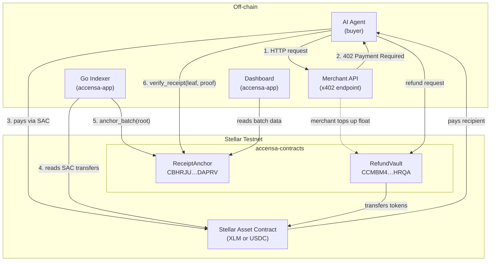
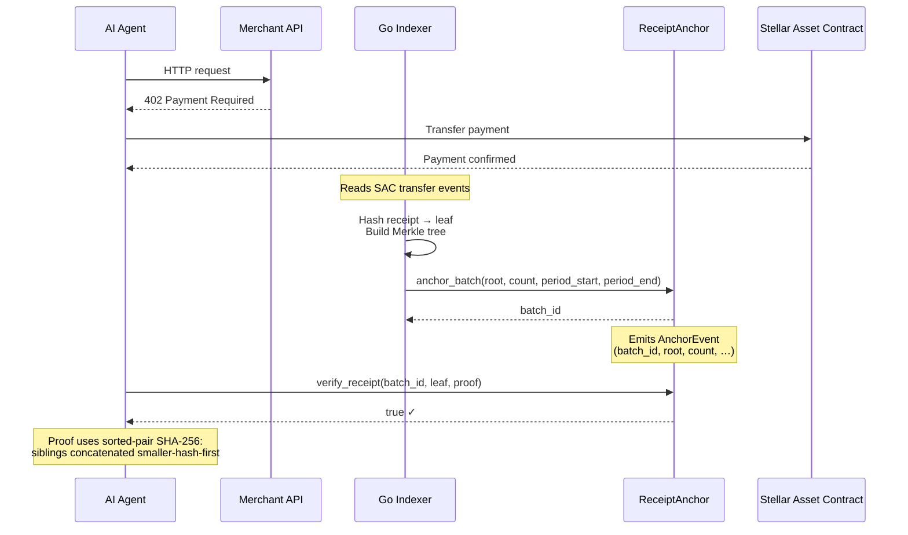
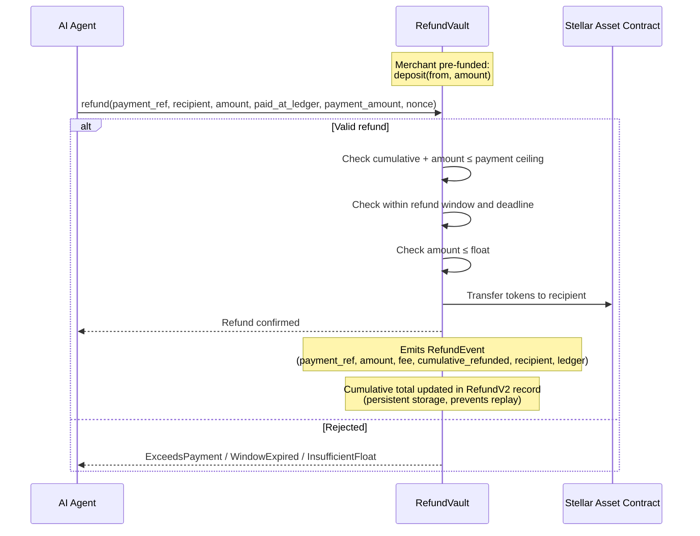
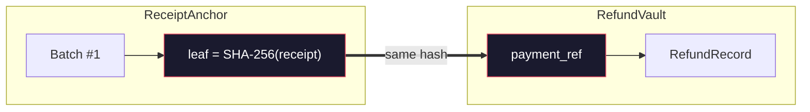

# Architecture

System overview of the Accensa contracts workspace. The workspace builds the
nineteen members listed in the root `Cargo.toml`: seventeen deployable
contracts, plus `common` (a shared library crate) and `testutils` (a
test-support crate excluded from the wasm build). The
[Contract Inventory](#contract-inventory) table below names every member with
a one-line role. The sections after it keep the detailed walkthrough of the
two headline contracts, `ReceiptAnchor` and `RefundVault`: both are
independent on-chain programs that share no storage — they are linked only by
a common identifier (`payment_ref` = receipt leaf hash).

For the threat model, see [SECURITY_MODEL.md](SECURITY_MODEL.md).
For live contract IDs and verification commands, see [DEPLOYMENTS.md](../DEPLOYMENTS.md).

## Contract Inventory

Every member listed in `Cargo.toml` `members`, with a one-line role:

| Crate | Role |
|---|---|
| `contracts/common` | Shared library: event definitions and types used by the contract crates; not deployed on its own. |
| `contracts/cross-chain` | Cross-chain messaging: Wormhole VAA, Axelar and LayerZero verification plus outbound bridge payloads. |
| `contracts/governance` | Proposals, timelocks and voting, plus the `stACC` liquid-staking derivative. |
| `contracts/insurance` | Insurance pool with Compound-style supply/borrow interest accrual. |
| `contracts/multisig-account` | Multisig account with batched execution. |
| `contracts/oracle` | Price oracle with admin-managed rounds and staleness bounds. |
| `contracts/privacy` | Groth16-verified escrow of concealed amounts against commitments. |
| `contracts/receipt-anchor` | Headline contract: anchors Merkle roots of payment-receipt batches and verifies receipts. |
| `contracts/receipt-shard` | Stores anchored receipt batches with TTL extension, pruning and decommission. |
| `contracts/reputation` | Reputation SBT: issue/revoke/slash badges plus fraud and completion scoring. |
| `contracts/refund-policy-time` | Refund policy bounded by ledger windows and wall-clock deadlines. |
| `contracts/refund-policy-vdf` | Refund policy gated by a VDF delay proof, with an oracle fallback path. |
| `contracts/refund-vault` | Headline contract: merchant-funded vault executing policy-bounded refunds, fees and yield. |
| `contracts/refund-vault-factory` | Deploys and tracks per-merchant refund vaults. |
| `contracts/state-channel` | Payment state channels with HTLC reservations. |
| `contracts/stream-vault` | Streaming payments: create, claim and cancel streams. |
| `contracts/testutils` | Test-support crate (`publish = false`); excluded from the wasm build, compiled by `cargo test`/`clippy --workspace`. |
| `contracts/treasury` | Treasury: vesting schedules, buybacks, fee liquidation and revenue sweeping. |
| `contracts/upto-authorization` | `upto` payment authorization with caps and expiry (x402-style flows). |

The walkthrough below keeps its original focus on `ReceiptAnchor` and
`RefundVault`, the two contracts deployed on testnet.

## System Overview

## Receipt Anchoring Flow

The indexer aggregates individual payment receipts into a Merkle tree and
anchors the root on-chain in a single transaction. Agents can then verify
their receipt independently — no trusted API in the path.

## Refund Flow

Refunds are policy-bounded: each `payment_ref` can only be refunded once,
must fall within the refund window, and cannot exceed the vault float.

## Cross-Contract Relationship

The two headline contracts, `ReceiptAnchor` and `RefundVault`, share no
storage and have no direct function calls. They are linked by a single shared
key:

| Contract | Field | Value |
|---|---|---|
| `ReceiptAnchor` | Merkle leaf | SHA-256 hash of the payment receipt |
| `RefundVault` | `payment_ref` | Same SHA-256 hash |

This 1:1 mapping means a refund in `RefundVault` explicitly corresponds to an
anchored receipt in `ReceiptAnchor`. The refund does **not** require the batch
to still exist — pruning or archiving a batch has no effect on refund validity.

## Testnet Deployment Context

Both contracts are deployed on Stellar testnet (v0.1.0). Key details:

| Property | Value |
|---|---|
| Merchant / admin | `GCALKSGAZRJLSUEJT3M5W6LN4R7XQOLIRCOS6ZA6EDZVTZDBIIPPFKJ6` |
| Refund token | Native XLM SAC (`CDLZFC3…YSC`) |
| Refund window | 17,280 ledgers (~24h) |
| Max batch size | 1,000 receipts |
| Storage TTL | ~30 days (~518,400 ledgers) |

> **Note:** The testnet contracts run v0.1.0 while `main` is at v0.3.0. The
> `main` functions (`prune_batches`, `pause`, `unpause`, yield paths, etc.) are
> not available at the deployed addresses. See [DEPLOYMENTS.md](../DEPLOYMENTS.md)
> for details.
