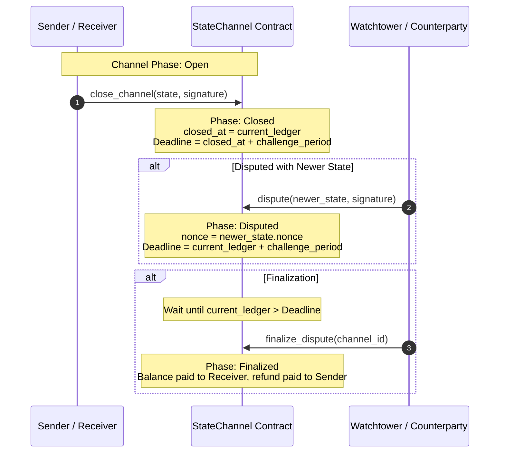

# StateChannel: Dispute Timeline and Challenge Windows

## Overview

The `StateChannel` contract provides high-frequency off-chain micro-payments anchored onto the Stellar network (issue #412, #1011). Two parties (Sender and Receiver) exchange signed state updates off-chain. The channel can be closed cooperatively without delay, or non-cooperatively through a dispute period if one party submits an obsolete state.

## Challenge Period and Timing Parameters

The contract defines three immutable timing constants governing dispute resolution:

| Constant | Value (Ledgers) | Wall-Clock Equivalent (~5s/ledger) | Description |
|---|---|---|---|
| `DEFAULT_CHALLENGE_PERIOD` | 720 | ~1 hour | Default window for submitting counter-evidence |
| `MAX_CHALLENGE_PERIOD` | 17,280 | ~24 hours | Maximum allowable dispute window configured during channel creation |
| `DEFAULT_MAX_CHANNEL_LIFETIME` | 1,209,600 | ~7 days | Maximum ledger duration a channel can remain open before expiring |

When opening a channel via `open_channel`, passing `0` as the `challenge_period` automatically sets it to `DEFAULT_CHALLENGE_PERIOD` (720 ledgers). Any value exceeding `MAX_CHALLENGE_PERIOD` is capped at 17,280 ledgers.

## Dispute Sequence and State Lifecycle

### Dispute Ledger Formulas
1. **Initial Cooperative Close:**
   $$\text{dispute\_deadline} = \text{closed\_at} + \text{channel.challenge\_period}$$
2. **Dispute Re-arm:**
   When counter-evidence with a higher nonce is submitted via `dispute()`:
   $$\text{new\_deadline} = \text{current\_ledger} + \text{channel.challenge\_period}$$
3. **Dispute Finalization Eligibility:**
   $$\text{current\_ledger} > \text{channel.closed\_at} + \text{channel.challenge\_period}$$

## Actor Roles and Response Windows

* **Sender / Receiver:**
  Parties who initiated and funded the channel. Can initiate mutual close or submit dispute counter-evidence during the active challenge window.
* **Watchtowers:**
  Authorized third parties monitoring channels. If an offline party is victimized by an obsolete state submission, the watchtower can invoke `dispute()` with newer signed evidence before `dispute_deadline` passes, protecting customer funds.
