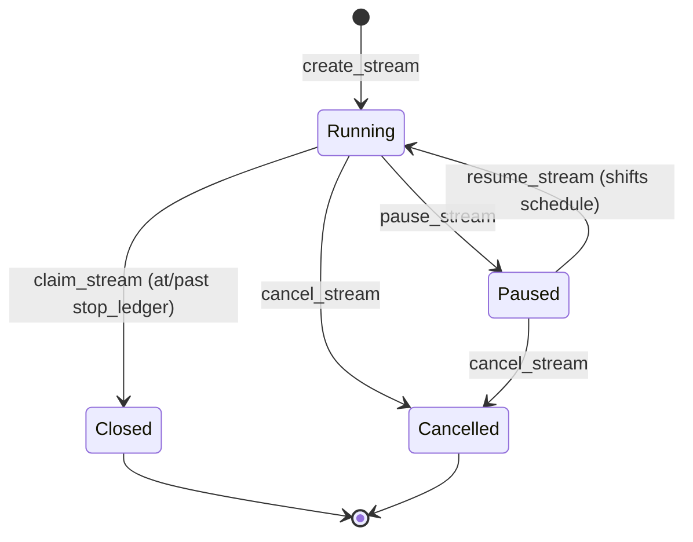

# StreamVault: Streaming Micro-Disbursement Architecture

## Overview

`StreamVault` enables continuous linear micro-disbursements from buyers to merchants (issue #410). A buyer escrows a `deposit` denominated in a specific SEP-41 token. The tokens stream linearly to the merchant at `rate_per_ledger` between `start_ledger` and `stop_ledger`.

At any ledger sequence `current_ledger`, the cumulative streamed amount is calculated as:
```text
min(deposit, (current_ledger - start_ledger) * rate_per_ledger)
```
The schedule's internal clock is clamped to the interval `[start_ledger, stop_ledger]` and is frozen while the stream is in a paused state.

## State Lifecycle

Streams transition through four lifecycle states:



### 1. Running
The initial state after `create_stream`. While running:
- Tokens accrue to the merchant at `rate_per_ledger` each elapsed ledger.
- `claim_stream` allows withdrawing accrued, unwithdrawn funds to the merchant.
- The stream can be paused or cancelled by the buyer.

### 2. Paused
A buyer may pause streaming at any time using `pause_stream`:
- The streaming clock freezes at the ledger of the pause call.
- No further tokens accrue to the merchant during paused ledgers.
- Calling `resume_stream` unfreezes the clock and shifts `start_ledger` and `stop_ledger` forward by the exact paused duration, preserving the total streaming duration.

### 3. Closed
When a stream reaches or exceeds its `stop_ledger`, calling `claim_stream` disburses the entire remaining deposit to the merchant and deletes the stream record from contract storage.

### 4. Cancelled
A buyer may terminate the stream before completion using `cancel_stream`:
- The merchant receives whatever amount has accrued up to the current ledger (less previously claimed amounts).
- The remaining unstreamed principal deposit is immediately refunded to the buyer.
- The stream record is removed from storage.

## Actor Permissions

| Role | Permitted Actions | Authorization Requirement |
|---|---|---|
| **Buyer** | `create_stream`, `pause_stream`, `resume_stream`, `cancel_stream` | `buyer.require_auth()` |
| **Merchant** | Receives streamed proceeds | Beneficiary specified in contract instance |
| **Keepers** | `claim_stream` | Permissionless (funds can only transfer to merchant) |

## Error Reference

| Error Variant | Numeric Code | Description | Integrator Recovery Action |
|---|---|---|---|
| `InvalidAmount` | 1 | Deposit or rate non-positive, or stop_ledger <= start_ledger, or rate cannot stream full deposit | Verify deposit, rate, and ledger bounds before creating stream |
| `SelfTransfer` | 2 | Buyer address matches the contract address | Ensure buyer is an external user or account, not contract |
| `StreamNotFound` | 3 | Stream ID does not exist or stream was already closed/cancelled | Verify stream ID; check if already completed or cancelled |
| `StreamNotActive` | 4 | Stream is not in required state (e.g. pausing an already paused stream) | Check stream status before calling pause/resume |
| `NothingToWithdraw` | 5 | No new tokens have accrued since the last claim | Wait for additional ledgers to elapse before claiming |
| `MathOverflow` | 6 | Schedule shift upon resume would exceed ledger limit `u32::MAX` | Do not pause streams indefinitely |
| `NotInitialized` | 7 | Contract lacks constructor configuration (merchant or token) | Ensure contract instance is initialized |
